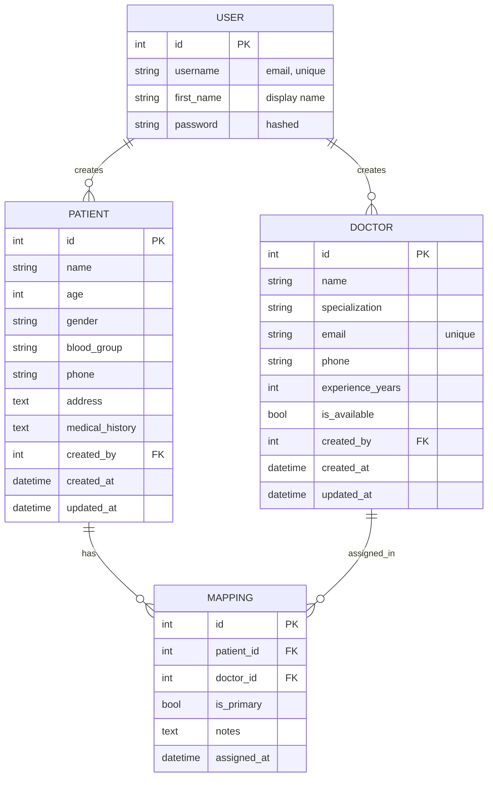

# Database Design

PostgreSQL, managed through the Django ORM and migrations.

## Entity relationship diagram

## Tables

| Table | Model | Purpose |
|---|---|---|
| `auth_user` | Django `User` | Accounts (email stored as username) |
| `patients_patient` | `Patient` | Patient records, owned by a user |
| `doctors_doctor` | `Doctor` | Shared doctor directory |
| `mappings_patientdoctormapping` | `PatientDoctorMapping` | Doctor-to-patient assignments |

## Constraints and integrity

| Constraint | Where | Why |
|---|---|---|
| `UNIQUE (email)` | `Doctor` | One directory entry per doctor |
| `UNIQUE (patient, doctor)` | `PatientDoctorMapping` | No duplicate assignments |
| `UNIQUE (patient) WHERE is_primary` | `PatientDoctorMapping` | At most one primary doctor per patient |
| `ON DELETE CASCADE` on `created_by` | `Patient`, `Doctor` | Removing a user removes their records |
| `ON DELETE CASCADE` on `patient` / `doctor` | `PatientDoctorMapping` | No orphaned assignments |
| Age 0-130, experience 0-70 | model validators | Reject unrealistic values |
| Phone regex | model validator | Consistent phone formatting |

Every table except `User` and the mapping table also carries `created_at` / `updated_at` through the shared
`TimeStampedModel` base class in `core/models.py`.

## Ownership model

- `Patient.created_by` decides who can see and change a patient.
- `PatientDoctorMapping` has no owner column; ownership is derived through `patient.created_by`, so a mapping
  can never belong to a different user than its patient.
- `Doctor.created_by` only controls who may modify or delete the doctor; reading is open to all signed-in users.
