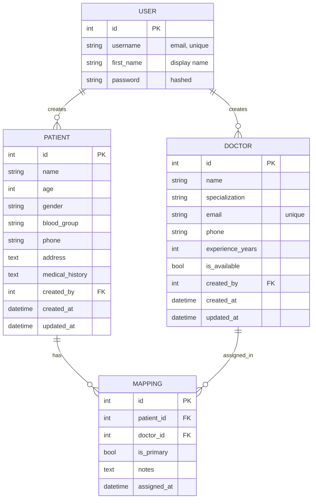

# Database Design

CareLink stores its data in PostgreSQL. I define the tables as Django models and let migrations create them, so I never write SQL by hand. This page explains what the tables look like, how they relate, and which rules the database itself enforces.

## How the tables relate

The design is small. A user creates patients and doctors, and a mapping row connects one patient to one doctor.

In plain words: one user can create many patients and many doctors. A patient can have many doctors, and a doctor can have many patients, and the mapping table is what joins them.

## The tables

| Table | Django model | What it holds |
|---|---|---|
| `auth_user` | `User` (built in) | Accounts. I store the email in the username field, so people log in with it |
| `patients_patient` | `Patient` | Patient records, each owned by one user |
| `doctors_doctor` | `Doctor` | The shared doctor directory |
| `mappings_patientdoctormapping` | `PatientDoctorMapping` | Which doctor is assigned to which patient |

I used Django's default `User` model instead of writing a custom one. A custom user model is usually the better choice for a long-lived project, but for this scope it would have added more code than it was worth.

Patients and doctors both get `created_at` and `updated_at` columns from a small shared base class (`TimeStampedModel` in `core/models.py`). The mapping table only has `assigned_at`, since a mapping is never really "edited" apart from its notes and primary flag.

## What the database enforces

These rules are enforced by PostgreSQL itself, so they hold even if something bypasses the API (a script, the admin panel, or two requests arriving at the same moment).

| Rule | Table | Why I added it |
|---|---|---|
| Doctor email is unique | `Doctor` | One directory entry per doctor |
| A patient and doctor pair can only appear once | `PatientDoctorMapping` | No duplicate assignments |
| Only one row per patient can have `is_primary = true` | `PatientDoctorMapping` | A patient has at most one primary doctor |
| Deleting a user deletes their patients and doctors | `Patient`, `Doctor` | Nothing is left pointing at a user that no longer exists |
| Deleting a patient or doctor deletes their mappings | `PatientDoctorMapping` | No orphaned assignments |

The one-primary-doctor rule is a partial unique constraint: it's a unique index on `patient` that only applies to rows where `is_primary` is true. PostgreSQL supports this directly, and Django lets you declare it in the model.

The API also checks these same rules before saving, so the user gets a clear error message instead of a raw database error.

## What the app enforces, not the database

A few rules are checked by Django's validators when data comes in through the API. They aren't database constraints, so something that writes to the tables directly could get around them.

- Age must be between 0 and 130
- Experience years can't go above 70
- Phone numbers must match a simple pattern (7 to 20 characters: digits, spaces, dashes, optional leading `+`)
- Gender and blood group must be one of the allowed choices

If this were a bigger system I'd move the numeric ranges into `CHECK` constraints as well. For this project, validating at the API boundary seemed enough.

## Who owns what

- `Patient.created_by` decides who can see and change a patient.
- The mapping table has no owner column. A mapping belongs to whoever owns its patient, so a mapping can never end up belonging to a different user than the patient it describes.
- `Doctor.created_by` only controls who can edit or delete a doctor. Every logged-in user can read all doctors.

## Possible improvements

- Soft deletes for patients, so records are hidden instead of destroyed, plus an audit log of changes
- `CHECK` constraints for the age and experience ranges
- Indexes on the fields people search and filter most (name, specialization), once there's enough data to need them